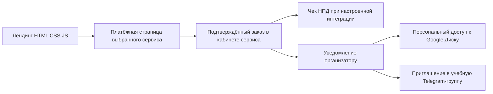

# Лендинг курса «Нейросети для проектирования: от чата до ассистента»

Актуальная архитектура и схема страницы на 10 ноября 2026 года. Заменяет первоначальный план с учебной платформой. Документ описывает предложение к реализации; сайт, оплату и Google Диск он не настраивает.

## 1. Принятые решения

- Курс проходит потоком: пять недель, одно трёхчасовое занятие в неделю, всего 15 часов. Старт — 23 ноября 2026 года.
- Формат обратной связи — групповые разборы вопросов и заданий; есть Telegram-группа обучения и группа выпускников после курса.
- Исполнитель принимает оплату как самозанятый.
- Нужен самостоятельный лендинг без GetCourse.
- Методички размещаются на Google Диске.
- Доступ к методичкам персональный, по Google-аккаунту участника.
- Материалы доступны без ограничения времени; скачивание, копирование и печать для читателей запрещены. Настройки всех шести PDF проверены 10 ноября 2026 года: запреты уже установлены, менять их не потребовалось.
- Визуальные ориентиры — приложенные текстовые описания AWE и Dala.
- Программа формируется по собственным PDF; academii.ru/ai используется как пример подачи программы.

Не определены: стоимость, время начала занятий, предельное число участников, точный порядок сопровождения и возвратов, наличие записей, сервис видеовстреч и состав ведущих. Календарь пяти еженедельных занятий: 23 и 30 ноября; 7, 14 и 21 декабря 2026 года. Подготовка проходит до первого занятия.

Актуальное [исследование цены, платёжных сервисов и ограничений PDF](исследование-цены-и-оплаты-2026-11-10.md) содержит обоснование предлагаемых цен и сравнение способов оплаты без ЮKassa. Цены и сервис пока не утверждены.

## 2. Изученные материалы и пределы проверки

Проверена папка `C:/Users/askko/проекты/Курс по аналогу/курс-по-аналогу/выпуск-с-обложками-2026-11-10/PDF`:

| Материал | Страниц PDF | Что даёт лендингу |
| --- | --- | --- |
| 00 — Подготовка.pdf | 163 | Состав первоначальной подготовки и вопросы, которые нужно разобрать до старта. |
| 01 — Модуль 1.pdf | 54 | Выбор задач, понимание возможностей ИИ, работа с документами и личная стратегия. |
| 02 — Модуль 2.pdf | 29 | Постановка задачи, уточнение, проверка ответа и сохранение рабочего способа. |
| 03 — Модуль 3.pdf | 30 | Настройка своего ассистента в проектах Claude. |
| 04 — Модуль 4.pdf | 34 | Документы, база знаний, ответы по источникам и исследование пробелов. |
| 05 — Модуль 5.pdf | 36 | Чертежи, текстовая часть, расчёты, согласованность разделов и сохранение настройки. |

Из всех шести файлов извлечён текст. Изучены оглавления и вводные разделы для составления программы; просмотрены обложки и отдельные содержательные страницы. Это не полная методическая экспертиза всех страниц и не повторная проверка актуальности интерфейсов сервисов.

Сайт [АкадемИИ](https://academii.ru/ai) полезен как пример последовательности «результат модуля → содержание», объяснения живых занятий, практики и сопровождения. Его сроки, расписание, отзывы, лицензия и условия доступа не являются сведениями о нашем курсе. Программу не расширяем чужими темами, которых нет в собственных материалах.

## 3. Программа для страницы

Названия ниже сокращены для лендинга. Их содержание опирается на оглавления и вводные разделы PDF; это редакционная подача существующей программы.

| Этап | Название на лендинге | Содержание | Предметный результат |
| --- | --- | --- | --- |
| 00 | Подготовка к обучению | Проверка необходимых аккаунтов, инструментов и условий работы; подготовка разрешённых исходных материалов. | Участник понимает, что потребуется к первому занятию и как подготовить рабочее место. |
| 01 | Находим задачи для ИИ в своей работе | Возможности и ограничения моделей; выбор операций; чтение документов; контекст; личная стратегия. | Перечень собственных задач и понятные критерии проверки результата. |
| 02 | Ставим задачу и проверяем ответ | Исходные данные, запрос, уточнение неизвестного, доработка ошибок, продолжение длинной работы. | Проверенный запрос, принятый результат и запись того, как работа выполнена. |
| 03 | Настраиваем своего ассистента | Проект в Claude, постоянная инструкция, общие материалы и данные текущей задачи, контрольные примеры, сохранение версий. | Настройка ассистента для одного повторяющегося рабочего процесса. |
| 04 | Добавляем базу знаний | Подготовка документов, реестр источников, проверка чтения, поиск, исследования и ответы с основаниями. | Ассистент с подготовленными материалами и порядком проверки ответов по источникам. |
| 05 | Применяем ассистента в проектировании | Подготовка крупного чертежа, проверка листов, текст по чертежам, расчёты, связи разделов, повторяемая проверка. | Рабочий проект ассистента, реестр документов, проверенный результат и отдельная копия настройки. |

Каждый пункт программы на странице содержит: краткую тему, 3–5 содержательных пунктов, практическое действие и результат. Полное описание раскрывается по нажатию. Основные модули соответствуют пяти еженедельным занятиям; подготовка выделяется отдельно.

Основной смысл предложения: научиться проходить рабочую цепочку от постановки задачи до проверенного результата, а затем сохранять её в собственном ассистенте. Готовность инженера принимать результат важна на каждом этапе.

### Предварительный текст первого экрана

Надзаголовок: «Практический курс для проектировщиков».

Заголовок: «Нейросети для проектирования: от чата до ассистента».

Пояснение: «Научитесь ставить задачи ИИ, проверять ответы по своим документам и настраивать помощника для работы с чертежами, текстовой частью и расчётами».

Строка формата: «Старт 23 ноября · 5 недель · 5 занятий по 3 часа · групповые разборы». Для исходников указывается условие: только разрешённые к такой обработке документы.

Основное действие: «Записаться на поток». Вторичное: «Посмотреть программу».

Цена до утверждения не публикуется. До открытия продаж основная кнопка может вести в лист ожидания с честным объяснением состояния набора. В блоке материалов до оплаты явно указать бессрочный просмотр через Google-аккаунт без скачивания и печати.

## 4. Визуальное направление по AWE и Dala

Рекомендуемая композиция: тёмная инженерная галерея. Из AWE берём спокойную чёрную основу, тонкие разделители и крупные изолированные высказывания. Из Dala — асимметрию, свободное пространство и иерархию за счёт масштаба шрифта. Переносим принципы композиции, а не весь набор цветов и компонентов.

Предлагаемая исходная палитра для прототипа:

- Фон: `#08090A`.
- Основной текст: `#E8E7E3`.
- Вторичный текст: `#A2A6A8`.
- Структурные линии: `#292C2F`.
- Основная кнопка: светлая на тёмном фоне, с чётким состоянием наведения и фокуса.
- Цветной акцент — преимущественно в содержательном визуале; окончательный оттенок выбирается вместе с ним.

Контраст всех реальных сочетаний проверяется в макете. Не переносим малоконтрастные микроподписи референсов в важный текст формы.

### Первый экран

Слева — крупный заголовок обычного начертания, короткое пояснение и одна основная кнопка. Справа — собственный инженерный визуал: исходный лист, выделенные сведения, связь с фрагментом инструкции и проверенный результат. Можно показать превращение чертежа в структурированную информацию.

Для визуала достаточно SVG и небольшой CSS-анимации. При уменьшенном движении показывается статичная версия. Тяжёлая трёхмерная сцена для этого смысла не обязательна. Если будет нужна авторская растровая иллюстрация, её создаём отдельным этапом по согласованной композиции.

Шрифт выбираем с качественной кириллицей и понятной веб-лицензией. Масштаб из референсов адаптируем под длинное русское название; коммерческие гарнитуры из описаний автоматически не подключаем. Декоративный шрифт, если появится, используется дозированно. Основной текст остаётся достаточно плотным для чтения, без механического переноса сверхтонкого начертания Dala.

### Остальные блоки

- Программа — крупные номера 00–05, строки тем, тонкие разделители и раскрытие подробностей.
- Демонстрация — широкий фрагмент реальной учебной задачи с пояснениями.
- Материалы — несколько страниц методичек в контексте обучения, а не сплошная галерея обложек.
- Авторы — фотографии без декоративных рамок и короткие подтверждённые биографии.
- Стоимость — один ясный блок участия с формой; дополнительные тарифы только при реальном различии условий.

Существующие обложки PDF насыщены роботами и цветным свечением. Их можно показывать как изображения комплекта, но перенос всех обложек в первый экран ослабит выбранную сдержанную композицию. Сами PDF в рамках задачи не переделываем.

## 5. Последовательность страницы

| Блок | Содержание | Действие посетителя |
| --- | --- | --- |
| Шапка и первый экран | Название, результат, формат и утверждённые параметры потока. | Перейти к программе или записи. |
| Знакомые рабочие задачи | Документы, замечания, чертежи, текстовая часть, повторяемые проверки. | Узнать свою задачу. |
| Одна задача в работе | Исходник → постановка → ответ → сверка → результат. | Посмотреть, чему именно учат. |
| Программа 00–05 | Темы, практика и результат по PDF. | Оценить содержание и уровень. |
| Как проходит поток | Пять трёхчасовых встреч с 23 ноября, групповая практика, Telegram-группа обучения и дальнейшая группа выпускников. | Понять обязательства по времени и порядок общения. |
| Что остаётся у участника | Настройка ассистента, инструкция, реестр, проверенный результат и методички. | Оценить предметный итог. |
| Авторы | Реальные роли, опыт и примеры. | Понять, кто ведёт обучение. |
| Стоимость и форма | Цена, поток, состав участия, условия и короткая запись. | Оформить заказ и перейти к оплате. |
| Вопросы и подвал | Подготовка, дополнительные расходы, Google-аккаунт, пропуски, возвраты, контакты и документы. | Устранить оставшиеся вопросы. |

Кнопки записи ведут к одному блоку. На телефоне допустима компактная закреплённая кнопка, если она не закрывает содержание, согласия и поля.

## 6. Техническая архитектура

Рекомендуемая схема первого запуска без GetCourse и ЮKassa:



Предложенные кандидаты — Prodamus «Старт для самозанятых» и Robokassa с «Робочеками СМЗ». Они не подключались и договором не утверждены. Сравнение и условия есть в отдельном исследовании. Ключи и реквизиты платёжного сервиса не помещаются в исходники сайта.

Лендинг остаётся статичным, на текущем HTML/CSS/JS. Для фиксированного продукта можно использовать готовую платёжную ссылку: оформление, приём денег, учёт заказа и чеки выполняет выбранный провайдер, учебные доступы выдаются вручную. В таком варианте свой сервер не нужен. Название потока и сумма на платёжной странице должны совпадать с условиями лендинга.

Если понадобятся автоматическое создание заказов, резервирование мест и выдача доступов, можно добавить один небольшой сервис на поддерживаемом Node.js и базу SQLite с резервным копированием на хостинге в РФ. Эта автоматизация не является обязательной для первого потока. Отдельный личный кабинет, CMS и большая административная система не требуются. Фактический хостинг текущего сайта следует проверить до публикации.

Ручной резервный путь: организатор принимает заявку, создаёт индивидуальный счёт и подтверждает участие по фактическому поступлению денег. На странице объясняется дальнейший порядок и не обещается немедленный учебный доступ.

### Страницы

- `/` — лендинг курса с блоком `#enroll`.
- `/order/` — состояние заказа по защищённой ссылке, если выбран обработчик; персональные данные по одному последовательному номеру заказа не выдаются.
- `/offer/`, `/privacy/`, `/consent/` — утверждённые документы.
- `/thanks/` — информационная страница; без заявления «оплачено», если нет подтверждённого статуса.
- `/calc/` — сохранить существующий адрес до отдельного решения.

Методички, данные участников, выгрузки заказов и ключи не попадают в публичные файлы сайта или GitHub. Шесть PDF уже находятся в предоставленной пользователем папке Google Диска; проверены параметры запрета скачивания, копирования и печати. Тест под отдельным аккаунтом ученика ещё нужен.

## 7. Форма и оплата

В форме достаточно имени, email и выбора потока/участия, если вариантов несколько. Пояснить, что адрес нужен для связи и чека. Для доступа потребуется Google-аккаунт; если его адрес отличается, собрать второй адрес после оплаты в переписке либо через защищённую форму. Не требовать вход в Google ради просмотра лендинга и оплаты.

Условия покупки, отдельное согласие на обработку данных там, где оно требуется, и необязательное согласие на рекламные письма имеют разные назначения. Не объединять их одним предварительно отмеченным флажком.

Порядок:

1. Участник переходит с лендинга на настроенную страницу курса у выбранного провайдера.
2. Провайдер оформляет заказ и показывает утверждённые условия и цену.
3. Посетитель оплачивает. Сайт не получает реквизиты карты.
4. Провайдер фиксирует фактический результат и формирует чек НПД, если соответствующая интеграция настроена и проверена.
5. Организатор сверяет заказ в кабинете, выдаёт доступ выбранному Google-аккаунту и учебной группе.
6. Участник получает инструкцию по материалам и занятиям; выдача доступа отмечается в рабочем реестре.

Возврат из банка не доказывает оплату. Закрытая вкладка банка не должна мешать учёту оплаченного заказа. При добавлении своего обработчика он проверяет уведомления по правилам выбранного провайдера, сверяет сумму и номер заказа и безопасно обрабатывает повторную доставку.

### Чек самозанятого

Prodamus и Robokassa заявляют автоматическую работу с чеками НПД после соответствующего подключения. До продаж нужно проверить, что чек действительно появляется в «Мой налог» и направляется покупателю. Для обычного банковского перевода предусмотреть ручное оформление или проверенный банковский продукт. Электронная платёжная квитанция чек НПД не заменяет. Подробности — в исследовании оплаты.

Срок выдачи доступа согласуется заранее и указывается до оплаты. Например, можно принять обслуживание в рабочее время с конкретным предельным сроком, но фактическое значение задаёт организатор. «Мгновенный доступ» для ручной выдачи не пишем.

### Что видит организатор

В реестре раздельно видны оплата, чек, доступ к материалам и отправка письма. Успешная оплата не означает, что все остальные действия уже выполнены. Минимальные сведения: номер заказа, поток, вариант участия, сумма, email, идентификатор платежа, время и версия принятых условий, адрес Google-аккаунта при его отличии и статусы дальнейших действий.

Проверить до продаж: отмену, задержку подтверждения, повторную оплату, ошибку email, отсутствие письма, заполненный поток и возврат. Если мест немного, нужен резерв с согласованным сроком и проверкой на сервере; если остаёмся без обработчика — последние места подтверждаются до выставления счёта.

## 8. Google Диск: выбранная схема доступа

Для первого потока рекомендована ручная персональная выдача после подтверждения оплаты. Автоматизация Google API не требуется для старта. Подтверждён выбор именно персонального доступа; ручной порядок — предлагаемая организация работы.

Структура:

```text
Материалы курса — служебная папка, доступ только организаторам
  Поток [название или дата]
    00 — Подготовка
    01 — Модуль 1
    02 — Модуль 2
    03 — Модуль 3
    04 — Модуль 4
    05 — Модуль 5
```

Участнику даётся роль читателя на папку его потока либо на уже открытые модули — в зависимости от выбранного порядка выдачи. Доступ «всем по ссылке» отключён. Разрешения служебной родительской папки участникам не выдаются. В учебных папках нет реестров учеников, чеков, телефонов и переписки.

После приглашения проверить доступ именно под адресом участника. Если оплачено с одного адреса, а Google открыт под другим, объяснить переключение аккаунта и порядок исправления адреса. Для учебных или корпоративных Google-аккаунтов возможны ограничения организации — их проверяем на пробном участнике. [Справка Google об управлении доступом](https://support.google.com/drive/answer/7166529?hl=ru).

Пересланная ссылка не даёт постороннему доступ без разрешения. Скачивание, копирование и печать для читателей уже отключены у всех шести PDF; для новых файлов эти параметры нужно проверять отдельно. Снимки экрана и фотографирование технически остаются возможны. Готовые запросы и пустые рабочие формы можно дать отдельно в учебной среде, чтобы участникам не приходилось перепечатывать их из PDF.

В первом письме: подтверждение участия, дальнейшие даты, срок открытия материалов, адрес аккаунта для доступа, инструкция по открытию Google Диска и контакт поддержки. Ссылки на платные материалы не размещаются в HTML, общедоступном JS или статичной странице «Спасибо».

Материалы доступны без ограничения срока. При возврате разрешение меняется по согласованным условиям; сам факт завершения пяти недель не закрывает доступ к PDF. После обучения предусмотрена группа выпускников для обратной связи, вопросов и предложений. Автоматическую выдачу через Google API можно добавить позднее, если объём ручной работы станет существенным.

### Данные участников

Первичный реестр заявок и заказов планируем в РФ. Google Диск используется для методичек; передача Google адреса участника при персональном приглашении требует отдельно определить правовое основание и применимость требований к трансграничной передаче. Наличие российской базы само по себе не решает этот второй вопрос. Условия обработки и получателей нужно отразить в документах до запуска. [Сбор данных, статья 18](https://www.consultant.ru/document/cons_doc_LAW_61801/cbf4e15b7c330f9372e876cdf2bc928bad7950ef/), [трансграничная передача, статья 12](https://www.consultant.ru/document/cons_doc_LAW_61801/e4ebbe1780de623c7cf32a59ca82a7bb523a25dd/).

Это не отказ от выбранного Google Диска: хранение учебных PDF и передача персональных данных — разные части схемы, которые нужно учесть.

## 9. Что изменить в существующем сайте

Сохраняем простой стек и существующий репозиторий. Аудит первой версии остаётся применимым:

- В index.html:270 заменить предложение внедрения для организаций на предложение обучения.
- В index.html:396 убрать расчёты экономии организации из продажи курса, пока нет доказательств такого результата обучения.
- В index.html:424 заменить пакеты внедрения стоимостью 235 000–2 300 000 рублей условиями участия в курсе.
- В index.html:20 и :86 переработать неоновое оформление и декоративный шар под новую композицию.
- Стили из index.html:16 перенести в актуальный css/style.css; поведение из index.html:619 — в js/main.js.
- В index.html:226 исправить скрытие содержания до работы JavaScript.
- Старую валидацию Formspree не подключать к новой форме: обработка зависит от выбранной схемы заказов.
- Подготовить новые title, description, canonical, изображение предпросмотра ссылки и карту страниц.
- Добавить утверждённые условия участия, контакты исполнителя и документы.
- Уточнить действующий хостинг перед настройкой обработчика и публикацией.

Содержание и публичные ссылки доступны без анимации. Для программы и вопросов достаточно нативного раскрытия details/summary; изображения загружаются в нужном размере, тяжёлое видео — только по действию. На телефоне сохраняются читаемость и последовательность страницы.

## 10. Подготовка материалов к выдаче

В подготовительном PDF на физических страницах 3 и 93 есть служебные блоки «Блок автора: проверить перед выпуском». Первый прямо указывает, что подключение и работа на устройствах пока не проверены и эту версию до проверки не следует выдавать ученикам. Это наблюдение о текущем файле, а не результат собственной проверки описанных сервисов.

Перед загрузкой для участников требуется завершить перечисленную проверку и подготовить ученическую редакцию без служебных пометок. Эти изменения относятся к курсу и в данной задаче не выполняются. Нельзя просто удалить пометку, не выполнив обозначенную проверку.

Также согласовать названия на обложках и в программе сайта: внутри PDF формулировки местами подробнее и отличаются от коротких названий на изображениях. На лендинге использовать понятную единую нумерацию 00–05.

## 11. Порядок реализации

1. Зафиксировать параметры первого потока, состав ведущих и порядок сопровождения. Проверить, что публичные обещания соответствуют программе.
2. Подготовить два варианта ключевых блоков по AWE/Dala: первый экран, фрагмент программы и стоимость с формой. На этом этапе используются материалы курса, а не случайные заглушки.
3. Выбрать схему оплаты: статичный сайт с ручными счетами либо автоматический обработчик заказов. До подключения проверить условия сервиса для самозанятого и выдачу чека.
4. Согласовать значительную переделку сайта по конкретному макету. Сохранить страховочный коммит нужных файлов, не включая автоматически чужие незакоммиченные изменения.
5. Реализовать страницу в текущем стеке и подключить выбранную запись. Не создавать кабинет ученика, учебную платформу или автоматизацию Google API без отдельной необходимости.
6. Настроить папку пробного потока и проверить персональный доступ на тестовом Google-аккаунте. Утвердить письма и срок ручной выдачи.
7. Проверить сайт на телефоне и компьютере, управление клавиатурой, масштаб, видимый фокус, ошибки формы, отсутствие скриптов, отмену и задержку платежа, чек, письмо и доступ.
8. Завершить ученическую редакцию материалов, документы исполнителя и условия работы с данными.
9. Выполнить проверку изменений → коммит → проверку секретов и состава публикации → push → проверку опубликованной страницы. Сохранить способ отката.

Критерий готовности: человек понимает программу и условия, может записаться и оплатить выбранным способом, получает чек и доступ в обещанный срок; организатор видит, какие действия по каждому участнику завершены.

## 12. Осталось определить

- Время встреч, число участников и цена; дата и длительность уже подтверждены.
- Один вариант участия или несколько; различия сопровождения.
- Ведущие, фотографии и подтверждённые сведения об опыте.
- Порядок видеозанятий и обратной связи.
- Срок первоначального открытия материалов после оплаты; продолжительность доступа уже подтверждена как неограниченная.
- Выбор готовой платёжной страницы либо индивидуального счёта; необходимость собственной автоматизации рассматривается отдельно.
- Данные исполнителя для подключения платежей и документов.
- Проверка просмотра под отдельным Google-аккаунтом ученика; папка и файлы уже предоставлены и настройки скачивания проверены.

Работу над схемой страницы и визуальными вариантами можно продолжать до определения цены и времени встреч. Продажи включаются после настройки полного пути участника и проверки фактических условий.
