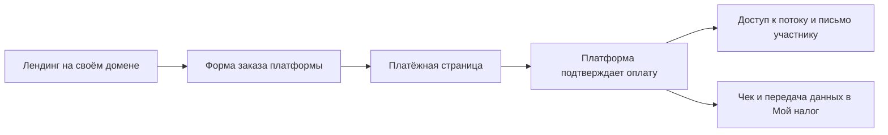

# План лендинга курса «Нейросети для проектирования: от чата до ассистента»

Архив первоначального предложения. После уточнения пользователя актуальна [архитектура самостоятельного лендинга](архитектура-лендинга-курса.md): без GetCourse, с методичками на Google Диске и персональным доступом. Рекомендации платформы ниже не являются текущим решением.

Дата проверки: 10 ноября 2026 года. Статус: предложение для обсуждения, до изменения сайта.

## 1. Основание и границы

Подтверждено автором:

- Вместо сайта услуг нужен рабочий лендинг курса.
- Курс проходит потоком, с занятиями и обратной связью.
- Оплата принимается от имени самозанятого.
- Референсы для нового оформления автор пришлёт отдельно.
- На сайте нужны запись и оплата.

Рабочая аудитория по контексту проекта — инженеры-проектировщики. Кто именно является основным покупателем, какие специальности охватывает курс и какой нужен начальный уровень, предстоит уточнить. Неизвестны программа, даты, длительность, цена, число мест и условия поддержки. Эти значения нельзя придумывать в публичных текстах.

Проверены локальные index.html, css/style.css, js/main.js, calc/index.html, README.md, .env.example, .gitignore, список отслеживаемых Git файлов и содержимое памятки/. Состояние опубликованной версии, DNS, сервера и платёжных кабинетов не проверялось. Встроенный браузер отклонил открытие локального file://; визуальная проверка компьютера и телефона остаётся отдельным этапом. Измерения скорости и полное исследование безопасности не проводились.

## 2. Что есть сейчас и что изменить

| Приоритет | Наблюдение и основание | Что сделать |
| --- | --- | --- |
| Высокий | index.html:270 — предложение о внедрении ассистентов для проектных организаций. Это другой продукт и другой покупатель. | Перестроить содержание вокруг обучения: кому подходит, что участник освоит, как проходит поток, сколько стоит участие. |
| Высокий | index.html:424 — пакеты внедрения за 235 000–2 300 000 рублей; кнопки ведут в Telegram. В главной нет формы, оформления заказа или оплаты. | Заменить пакетами обучения, если они действительно предусмотрены. Добавить форму заказа и проверяемое подтверждение оплаты. |
| Высокий | index.html:396 — расчёт экономии; index.html:570 — утверждения об опыте и базе знаний. Источники подтверждения в проверенных файлах не установлены. | Не переносить показатели окупаемости на курс. Биографии, результаты и кейсы публиковать после подтверждения автором. |
| Средний | index.html:16 — стили внутри HTML; index.html:619 — встроенный скрипт. css/style.css и js/main.js главной не подключены. | При реализации перенести актуальные стили и поведение в соответствующие файлы. Старую валидацию Formspree заменить под выбранную форму, не подключать её вслепую. |
| Средний | index.html:20, :86 — фиолетовый/бирюзовый акцент, светящиеся элементы, шар. Много однотипных карточек. | Разработать визуальную систему по новым референсам. Рекомендация основана на коде и пожелании автора, а не на просмотренном макете. |
| Средний | index.html:226 — элементы .reveal скрыты через opacity: 0 до работы JS. | Основной текст виден сразу. Скрипт добавляет анимацию только при успешной инициализации. |
| Средний | index.html:139 — подсказки карточек открываются через hover. | Существенный текст доступен по нажатию и с клавиатуры. Для программы и FAQ использовать понятное раскрытие. |
| Средний | В главной есть title, description, Open Graph, но нет canonical и изображения для предпросмотра; в отслеживаемых файлах нет sitemap и юридических страниц. | Переписать метаданные для курса, подготовить OG-изображение, адреса страниц, sitemap и нужные документы. |
| Низкий | README и памятки описывают прежние этапы, включая учебный Netlify. Более поздняя памятка и Git говорят о домене evgeniikotsur.ru. | Перед публикацией установить фактическую схему размещения. Обновить документацию, отделив действующие решения от истории. |

Сохранить можно репозиторий, домен, простой стек, адаптивную основу и поддержку уменьшенного движения. Фотографии сначала проверить на соответствие новому содержанию. /calc/ оставить по прежнему адресу до отдельного решения: калькулятор относится к работе бюро и не доказывает эффективность курса.

Это перечень продуктовых и технических изменений. Наличие подтверждённых уязвимостей платёжного контура не заявляется: такого контура в проверенной версии нет.

## 3. Логика главной страницы

Посетитель должен последовательно понять: подходит ли ему курс → чему он научится → почему можно доверять авторам → как проходит обучение → как записаться.

| Порядок | Блок | Содержание и действие |
| --- | --- | --- |
| 1 | Шапка | Название, ссылки «Программа», «Как учимся», «Авторы», «Стоимость», кнопка записи. На телефоне навигация не перекрывает страницу. |
| 2 | Первый экран | Точное название курса; одно конкретное объяснение результата; формат потока, дата и длительность после утверждения. Основная кнопка «Записаться на поток», вторичная — «Посмотреть программу». |
| 3 | Кому подходит | Рабочие ситуации и исходные навыки. Также честно обозначить границы: например, нужна ли самостоятельная работа и какие инструменты участник должен уметь использовать. |
| 4 | Пример работы | Одна реальная учебная задача: исходные данные → запрос → ответ → проверка → итоговый рабочий материал. Короткое видео по нажатию либо последовательность экранов. |
| 5 | Результаты обучения | Что участник сможет делать и какие материалы подготовит. Связать каждый результат с упражнением, а не с обещанием дохода или экономии. |
| 6 | Программа | Последовательность освоения курса. У каждого модуля — задача, практика и результат. Длинные подробности раскрываются, общая структура видна сразу. |
| 7 | Как проходит поток | Расписание в МСК, длительность занятий, нагрузка между встречами, домашние задания, кто отвечает и в какие сроки. Условия записей и доступа — если они предусмотрены. |
| 8 | Авторы и доказательства | Реальные фотографии, роли, подтверждённый опыт, фрагменты работ. Отзывы — только имеющиеся и с разрешением; до их появления использовать демонстрацию и открытый фрагмент занятия. |
| 9 | Стоимость и запись | Один базовый вариант участия на старте; дополнительные тарифы только при реальном различии сопровождения. Полная цена, состав, поток, условия оплаты и форма заказа. |
| 10 | Вопросы и контакты | Доступ к сервисам из РФ, обязательные подписки и их стоимость, начальный уровень, пропуск занятия, поддержка, возвраты. Повтор записи без дополнительных полей. |
| 11 | Подвал | Исполнитель, контакты, реквизиты, оферта, политика обработки данных и отдельное согласие. |

Пример сквозной линии содержания: работа с чатом → подготовка исходных документов → настройка помощника → проверка на инженерной задаче. Это предложение для подачи курса, а не утверждённая программа.

На первом экране полезнее показывать реальный фрагмент задания или итоговой работы, чем декоративную иллюстрацию нейросети. Конкретный состав выбирается после получения программы и референсов.

## 4. Архитектура страниц и сервисов

Рекомендуемый старт: собственный статичный лендинг + готовая платформа для заказов, участников и материалов курса. Кандидат, проверенный по документации: GetCourse с Get Модулем и подключением «Мой налог». Выбор сервиса пока не утверждён и подписки не оформлены.

Лендинг отвечает за содержание и оформление. Платформа хранит участников и заказы, управляет доступом. Платёжный сервис обрабатывает оплату. Основные данные заказа не дублируются в Formspree, таблицах и Telegram.

GetCourse поддерживает формы заказа на стороннем сайте. Для блока записи можно использовать официальный виджет, настроенный под оформление страницы. Обязателен запасной переход на форму платформы, если виджет не загрузился. Возможность нужной стилизации проверяется на прототипе. [Документация виджетов](https://getcourse.ru/blog/275829).

При подключённом Get Модуле доступ после оплаты зависит от настроек продукта и предложения. Для передачи продаж самозанятого в ФНС отдельно настраивается связь с «Мой налог»; одно подключение приёма денег её не заменяет. [Приём платежей](https://getcourse.ru/blog/951096), [интеграция с «Мой налог»](https://getcourse.ru/blog/1088960).

Предлагаемая карта адресов:

- / — лендинг курса.
- /#enroll — блок стоимости и заказа на той же странице.
- /offer/ — условия приобретения и участия.
- /privacy/ — политика обработки персональных данных.
- /consent/ — отдельный текст согласия, когда обработка основана на нём.
- /thanks/ — общая инструкция после оформления; без заявления об оплате, если страница не получает подтверждённый статус.
- Страница подтверждённого заказа и учебный кабинет — на выбранной платформе.
- /calc/ — сохранённый существующий адрес.
- /solutions/ — возможный адрес старого предложения услуг, только если автор решит сохранить это направление на сайте.

Для реализации достаточно текущих папок: index.html, css/style.css, js/main.js, images/ и отдельных папок юридических страниц. При росте стилей можно выделить файл оформления формы. Закрытые уроки и списки участников в публичный репозиторий не помещаются.

## 5. Запись и оплата глазами участника

1. Человек выбирает поток и вариант участия, видит дату старта, полную цену и состав.
2. Заполняет короткую форму: имя и email. Телефон — только если необходим для выбранного способа оплаты или связи; Telegram можно подключить после оформления. Специальность и учебную задачу лучше спросить после оплаты.
3. Видит условия участия и отдельные элементы подтверждения там, где они нужны. Согласие на рекламные письма необязательно и не отмечено заранее.
4. Платформа создаёт заказ с идентификатором потока, тарифом и актуальной ценой.
5. Человек переходит на защищённую платёжную страницу и выбирает доступный способ оплаты. Карточные данные на сайте курса не собираются.
6. После подтверждения платежа платформа фиксирует заказ, выдаёт предусмотренный доступ и отправляет письмо с дальнейшими действиями.
7. Участник получает чек; для самозанятого проверяется его оформление в связке с «Мой налог».
8. В кабинете организатора видны оплаченные участники, неоплаченные заказы, возвраты и список ожидания. Рассылки и напоминания настраиваются отдельно.

В первом письме нужны название и даты потока, номер заказа, ссылка на учебную среду, порядок подключения к первой встрече, контакты поддержки. Доступ к закрытому чату выдаётся после проверки права участия; общая ссылка на закрытый чат не хранится в публичном HTML.

| Состояние | Что видит участник | Что требуется от системы |
| --- | --- | --- |
| Заказ создан | Номер заказа и кнопка оплаты | Не считать заявку оплаченной; возможность вернуться к тому же заказу. |
| Ожидаем подтверждение | «Проверяем оплату» и понятная инструкция | Задержка уведомления не приводит к повторному списанию. |
| Оплачено | Подтверждение и дальнейшие шаги | Доступ выдаётся по подтверждённому состоянию заказа, даже если участник закрыл вкладку банка. |
| Платёж отменён или не прошёл | Повтор оплаты и поддержка | Не создавать дубли участников при повторной попытке. |
| Письмо не пришло | Проверка спама и повторная отправка из кабинета | Организатор может найти заказ и восстановить доступ. |
| Поток заполнен | Лист ожидания следующего набора | Закрыть возможность новых оплат. При жёстком лимите платформа должна контролировать последние места; это проверяется до запуска. |
| Возврат | Подтверждение обращения и статус | Оформить возврат и соответствующие действия с чеком; изменить доступ по условиям договора. |

Заявка без оплаты не означает забронированное место, если срок резерва и механизм его контроля не введены явно. Счётчик мест показывается только при наличии достоверных данных. Если платформа не обеспечивает нужный контроль последних мест, для них использовать подтверждение организатором до выставления счёта.

Рассрочку добавлять после расчёта экономики и проверки доступности у выбранного провайдера. Оплата частями от автора и банковский кредит требуют разных объяснений и условий; обещания «0%» без подтверждённых условий не публиковать.

## 6. Альтернатива: прямая интеграция ЮKassa

Если обучение будет организовано без полной учебной платформы, можно оставить лендинг и подключить ЮKassa напрямую. Сервис работает с самозанятыми и позволяет использовать платёжные ссылки либо интеграцию. Но он не заменяет учёт потока, хранение материалов и работу с доступами. На странице условий ЮKassa для самозанятых также указано, что через это решение платить могут физлица: оплату работодателем нужно рассматривать отдельно. [Условия для самозанятых](https://yookassa.ru/platezhi-dlya-samozanyatyh/).

Для автоматизации потребуется небольшая серверная часть и база заказов с размещением в РФ. Пример достаточного устройства — один сервис на поддерживаемой версии Node.js и SQLite с резервным копированием. Это отдельное изменение прежнего правила «без своего бэка», поэтому реализуется после выбора этой схемы.

Правила серверной интеграции:

- Цена и допустимый тариф проверяются на сервере; браузер передаёт выбор, а не назначает сумму.
- Ключи платёжного сервиса хранятся на сервере.
- Запрос на создание платежа допускает безопасный повтор без создания нового списания.
- Уведомление провайдера проверяется; актуальный платёж запрашивается через API. Сверяются магазин, заказ, сумма, валюта и успешный статус.
- Повторные уведомления не создают повторный доступ или письмо. Результат записывается до ответа провайдеру.
- Выдача доступа и письма имеют учёт результата и возможность повторить неудачную операцию.
- Периодическая сверка незавершённых платежей восстанавливает состояние после потери уведомления.
- Страница возврата из банка не является доказательством оплаты.

ЮKassa описывает проверку подлинности и повторную доставку уведомлений в документации. [Входящие уведомления](https://yookassa.ru/developers/using-api/webhooks).

Для небольшого пробного потока возможен ручной вариант: индивидуальный счёт, сверка платежа, чек через «Мой налог», ручное зачисление. Тогда на сайте честно указывается срок подтверждения; автоматический моментальный доступ не обещается. Это сокращает разработку, но требует времени организатора.

## 7. Стоимость и данные

По проверенным 10.11.2026 публичным тарифам GetCourse, «Старт» стоит 5 900 рублей за месяц. Дополнительно учитываются комиссия приёма денег и возможные расходы на хранение, видео и другие подключённые услуги. Индивидуальные условия и итоговую смету нужно проверить перед выбором. [Тарифы платформы](https://getcourse.ru/prices).

Сравнивать варианты следует по полной стоимости: подписка и комиссии против разработки, поддержки, хостинга и времени на ручные операции. При отсутствии данных о цене курса и размере потока нельзя уверенно назвать самый дешёвый вариант.

У самозанятого чек формируется через «Мой налог» самостоятельно либо предусмотренную интеграцию. ФНС также указывает годовой предел дохода для НПД 2,4 млн рублей: план продаж нужно соотнести с общим доходом автора по этому режиму. [Информация ФНС](https://npd.nalog.ru/).

Первичный учёт заявок и заказов планировать в российской инфраструктуре. В своей политике GetCourse заявляет размещение серверов обработки и хранения персональных данных в РФ. Это помогает выбрать схему хранения, но не заменяет настройки и документы самого организатора. [Политика платформы, раздел 7](https://getcourse.ru/privacy_policy/gc).

Нужны оферта с действительным исполнителем, правила участия и возвратов, политика обработки данных и корректное основание обработки. Если используется согласие, оно оформляется отдельно от других подтверждаемых документов. Условия покупки и рекламная подписка не объединяются одним обязательным флажком. [Статья 9 закона о персональных данных](https://www.consultant.ru/document/cons_doc_LAW_61801/6c94959bc017ac80140621762d2ac59f6006b08c/).

Перед продажами определить юридическую модель обучения, состав преподавателей и статус итогового документа. Наличие образовательной лицензии и возможность обещать конкретный документ нельзя выводить только из статуса самозанятого. Также установить обязанности организатора по уведомлению Роскомнадзора и поручению обработки выбранным сервисам.

## 8. Дизайн по референсам

До получения референсов окончательные цвета, шрифты и композицию не утверждать. Старые предпочтения из памяток — история прежнего продукта.

Предлагаемое смысловое направление для проверки по референсам: авторская инженерная мастерская. Отличительные материалы — реальные рабочие документы, изображения процесса, авторские пометки и результат учебной задачи. Если референсы предложат другое направление, сохранить связь визуала с реальным содержанием курса.

Как придать индивидуальность:

- Выразительная типографика с проверенной кириллицей, осмысленная иерархия, различный масштаб текста.
- Собственная композиция: крупный пример работы, раскрытая программа, фотографии авторов, компактный блок заказа. Разные задачи получают разные формы подачи.
- Один или несколько характерных приёмов из референсов: кадрирование, набор заголовков, работа с полями, контраст материалов. Не копировать готовую страницу целиком.
- Цвета выбирать вместе с изображениями и типографикой. Не назначать «нетипичный» акцент только ради отличия.
- Движение объясняет последовательность работы: например, появляются пометки проверки в демонстрации. Основное чтение и запись не зависят от анимации.
- Первый экран, программа и форма одинаково тщательно прорабатываются для телефона и компьютера.

Не использовать как основу текущие светящиеся шары, градиентные AI-значки и одинаковые карточки на каждом экране. Не добавлять выдуманные отзывы, показатели, искусственный таймер или недостоверное число оставшихся мест.

После референсов подготовить два разных композиционных направления на одном содержании: первый экран, фрагмент программы и блок записи для широкого и узкого экрана. Выбрать направление до полной вёрстки.

## 9. Современные технологии, которые полезны задаче

Технологический подход — основной текст в HTML, адаптивное оформление в CSS и небольшие скрипты для необходимых действий. Переписывание на React или сложную систему сборки для первого лендинга не требуется.

- CSS Grid/Flexbox, гибкая типографика через clamp(), при необходимости container queries. Последние позволяют подстраивать отдельный компонент под доступное ему место. [MDN: container queries](https://developer.mozilla.org/en-US/docs/Web/CSS/Guides/Containment/Container_queries).
- Нативные details/summary для раскрытия программы и вопросов; скрипты добавлять только для недостающего поведения. [MDN: details](https://developer.mozilla.org/en-US/docs/Web/HTML/Reference/Elements/details).
- Оптимизированные изображения WebP/AVIF с запасным форматом, заданными размерами и отложенной загрузкой ниже первого экрана. Видео загружается по действию посетителя.
- Локально размещённые шрифты с подходящей веб-лицензией, небольшое число начертаний.
- Основной контент и запасная ссылка на оформление доступны при ошибке скрипта. Дополнительные эффекты включаются при поддержке браузером.
- Доступность по WCAG 2.2 AA как цель: клавиатура, видимый фокус, подписи полей, понятные ошибки, контраст и уменьшение движения. Соответствие подтверждается проверкой, а не самим выбором HTML-элементов. [WCAG 2.2](https://www.w3.org/TR/WCAG22/).
- Для поиска: содержательный HTML, новый title/description, canonical, карта страниц, robots.txt и реальное изображение для предпросмотра ссылки.

Цели по Core Web Vitals: LCP ≤ 2,5 с, INP ≤ 200 мс, CLS ≤ 0,1. Это цели будущей версии, а не измеренные показатели текущего сайта. До трафика выполняются лабораторные проверки; затем оцениваются реальные посещения. [Рекомендации Google](https://developers.google.com/search/docs/appearance/core-web-vitals).

Аналитика отвечает на четыре вопроса: читают ли предложение, доходят ли до записи, начинают ли оформление, сколько заказов действительно оплачено. События: просмотр программы, нажатие записи, оформление заказа, подтверждённая оплата. Оплата учитывается по данным платформы; открытие /thanks/ не заменяет продажу. Email, телефон и содержимое анкеты в аналитику и URL не передаются. Подключение необязательных счётчиков согласуется с выбранной моделью обработки данных.

## 10. Порядок реализации и приёмка

1. **Уточнить продукт.** Собрать программу, результат, даты, цену, размер потока, роли авторов, поддержку, обязательные подписки на инструменты, условия материалов и возвратов. Результат — краткое описание курса с подтверждёнными фактами.
2. **Выбрать схему записи.** На небольшом тестовом примере проверить заказ, оплату, чек НПД и выдачу доступа. Сравнить расходы платформы и прямой интеграции. Результат — выбранный сервис и понятный путь участника.
3. **Собрать структуру и тексты.** Подготовить серую схему страницы с мобильной версией. Результат — утверждённая логика и список нужных материалов.
4. **Разработать оформление.** Разобрать новые референсы, показать два направления на ключевых фрагментах. Результат — выбранная система оформления.
5. **Реализовать в отдельной ветке.** Перед значительной переделкой подтвердить объём. Сохранить страховочный коммит отслеживаемых файлов, проверив незакоммиченные данные. Не включать автоматически пользовательский AGENTS.md и личные памятки.
6. **Подключить запись и документы.** Настроить поток, тариф, форму, оплату, чек, доступ, письма, лист ожидания. Результат — проверяемая цепочка от страницы до участия.
7. **Провести приёмку.** Проверить телефон, планшет, компьютер, клавиатуру, масштаб 200%, уменьшение движения, ошибку виджета, валидность ссылок и метаданных. Проверить успешную, отменённую, задержанную и повторную оплату; возврат; отсутствие письма; последний доступный слот. Использовать тестовый режим провайдера, где он предусмотрен.
8. **Подготовить публикацию.** Проверить изменения, сделать коммит, проверить секреты и состав публикуемых файлов, затем push и проверку опубликованной версии. Публикуется только набор публичных файлов: исключить .git, резервную историю, памятки, .env и служебные инструкции. Зафиксировать способ отката.
9. **Проверить первый настоящий заказ.** Организатор подтверждает фактическое зачисление, чек, письмо и доступ первого участника. Дальше менять страницу по наблюдаемым затруднениям, а не по случайным визуальным экспериментам.

Рабочий лендинг считается готовым, когда участник понимает предложение, может оформить и оплатить участие, получает подтверждение и следующий шаг, а организатор видит достоверный список заказов и может обработать нештатную ситуацию.

## 11. Что нужно для следующего этапа

- Обещанные референсы и пояснение, что именно в каждом нравится.
- Программа или существующее описание курса.
- Планируемая дата, длительность, стоимость и предельный размер первого потока.
- Состав авторов и проверенные биографии, фотографии, примеры работ.
- Выбор: учебная платформа либо более ручная организация первого потока.
- Правила сопровождения, материалов, переноса участия и возвратов.

До получения этих данных можно обсуждать архитектуру и создавать предварительную схему блоков. Фактические обещания курса и окончательный визуал остаются открытыми решениями.
